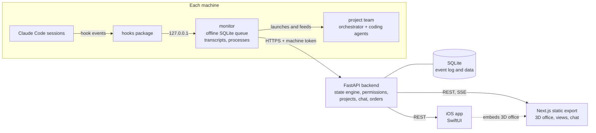

# Agent Office Visualizer

A live office, on the web, in 3D and on iPhone, that shows what every Claude Code agent is doing on every machine and lets you answer, approve and direct them from one place.

> This project extends [claude-office](https://github.com/paulrobello/claude-office) by Paul Robello and contributors (MIT). The first 232 commits of this repository are the upstream history, kept intact. This fork adds a 21-state agent engine, a per-machine monitor, a 3D office, permission approval, project teams led by an orchestrator agent, an iOS app and a self-hosted deployment.

## What it does

Working with several AI coding agents in parallel, across projects and machines, makes it hard to know who is working, who is blocked and who is waiting on you. This tool turns hook events into a clear status for each agent and adds controls to act on it.

**From upstream (claude-office)**

- Claude Code hooks package (`hooks/`) that reports session, prompt, tool and subagent events to a local backend.
- FastAPI backend skeleton, event models, path and process utilities, event simulation scripts.
- OpenCode plugin (`opencode-plugin/`) and the Makefile-based tooling.
- The original pixel-art PixiJS web was removed in this fork (commit `e819f50`); it is still available upstream.

**Added in this fork**

- **State engine** (`backend/app/core/agent_state_engine.py`): a catalog of 21 states (`docs/proyecto/catalogo-estados.md`), including who the agent is waiting for: you (permission or an explicit question), a long-running program, a network transfer or its own subagents. It keeps its own SQLite event log, detects closed sessions by process check and flags stalled agents.
- **Office views**: a 3D office (`/oficina/3d`) with switchable environments, a layout editor and color themes; a box view by urgency and by project (`/oficina`); an agent profile with turn history and token usage; a "Where we left off" view; and a raw data page.
- **Alerts**: voice and desktop notifications, with each alert summarized in one sentence by an isolated helper agent.
- **Permission approval** from the web or the phone. Dangerous commands (recursive deletes, `git push --force`, `DROP TABLE`, ...) always require approval.
- **Machine monitor** (`monitor/`): one background process per machine, Python standard library only, with an offline SQLite queue, transcript and process readers, and a Windows installer. It is the only component that holds the machine token.
- **Project teams**: the monitor launches an orchestrator session plus coding-agent sessions (`claude -p` with stream-json). You chat with the orchestrator; any work order it proposes waits for your approval (as written, edited or rejected with a reason) before it reaches a coding agent. Replies stream live over SSE with sent, read and typing indicators. Per-project house rules and a safe-command list are written into each team.
- **Decisions and Ideas inboxes** that collect everything waiting on you.
- **iOS app** (`ios/`, SwiftUI): projects, orchestrator chat, order approval, inboxes, native notifications, and the 3D office embedded in an app mode (`?app=ios`).
- **Login, machine tokens and deployment** (`despliegue/`): argon2 password login, per-machine tokens, nginx and systemd templates, HTTPS, daily backups and restore scripts.

## Architecture



1. Claude Code runs the hooks package on every event. On a machine with the monitor installed, events go to the monitor on loopback, which queues them in SQLite so nothing is lost if the server or network is down.
2. The monitor enriches events with transcript and process data, forwards them over HTTPS with its machine token, and polls the server for jobs: permission decisions, chat messages, approved orders, new projects.
3. The backend rebuilds the state of every agent each second from its own event log and serves the web and the iOS app. Chat replies stream through Server-Sent Events.
4. In production, nginx serves the static web at `/` and proxies `/api` to the backend, which runs under systemd. For local development the hooks can post directly to the backend.

## Tech stack

- **Backend**: Python 3.13, FastAPI, Pydantic, SQLite, argon2-cffi, uv, pytest, ruff, pyright.
- **Frontend**: Next.js 16 (static export), React 19, TypeScript, three.js with React Three Fiber and drei, Zustand, Tailwind CSS 4, Vitest.
- **Monitor and hooks**: Python (the monitor uses only the standard library), packaged as a Windows installer.
- **iOS**: Swift, SwiftUI, XcodeGen (`project.yml`), WKWebView for the 3D office.
- **Deployment**: nginx, systemd, Let's Encrypt, Bash scripts.

## Results

Test suites in this repository, run on a clean clone:

| Suite | Command | Result |
| --- | --- | --- |
| Frontend | `npx vitest run` | 320 / 320 passing |
| Frontend types | `npm run typecheck` | OK |
| Frontend build | `npm run build` | OK |
| Backend | `uv run pytest` | 477 tests; 474 pass on Windows (3 tests in `tests/test_path_utils.py` assume POSIX home paths, as in upstream) |
| Monitor | `uv run pytest` | 206 passing |
| Hooks | `uv run pytest` | 170 passing |

## Running locally

**Requirements**: [uv](https://docs.astral.sh/uv/) (Python 3.13 is installed by uv), Node.js or bun, `make`, and Claude Code for real events. For the iOS app: a Mac with Xcode and XcodeGen.

```bash
# Dependencies (does not install hooks into Claude Code)
make install

# Local configuration (not versioned)
cp backend/.env.example backend/.env           # VISUALIZADOR_AUTH=desactivado: login off locally
cp frontend/.env.example frontend/.env.local   # NEXT_PUBLIC_BACKEND_PORT=8100

# Backend on :8100 and web on :3100
make dev-local
```

Then, in another terminal:

```bash
curl http://127.0.0.1:8100/health

# Simulated agents, no Claude Code needed
CLAUDE_OFFICE_API_URL=http://127.0.0.1:8100/api/v1/events uv run python scripts/simulate_events.py complex
```

Open http://localhost:3100. The raw state engine output is at `/datos` or `GET /api/v1/agents/state`.

- `make hooks-install` registers the hooks in your Claude Code settings. Use it only when you want real sessions to report to the local backend.
- Edit `BACKEND_CORS_ORIGINS` in `backend/.env` to match the origins you actually use.
- The monitor installer is built with `cd monitor && uv run python empaquetar.py`; it asks for the server address and a machine token.
- Production settings are described in `backend/.env.produccion.example` and the scripts in `despliegue/`, which use the placeholders `<VPS_IP>`, `<VPS_USER>` and `agents.example.com`.

Tests:

```bash
cd backend  && uv run pytest -q
cd hooks    && uv run pytest -q
cd monitor  && uv run pytest -q
cd frontend && npm run typecheck && npx vitest run
```

The interface and `PROJECT.md` (decision log and stage plan) are in Spanish.

## What I learned / key technical decisions

- **I separated state from rendering.** Before drawing anything new, I wrote a 21-state catalog and a state engine with its own event log, validated against raw data on a debug page. The inherited database dropped events in bursts, so the engine could not depend on it. With reliable states, the 2D, 3D and iOS views became thin clients.
- **"Waiting on you" has to be explicit.** An agent that finished its turn is not necessarily waiting. I count it as waiting only on a pending `AskUserQuestion` or `ExitPlanMode`, or a question in the last paragraph of its message, and a closed session never waits. This removed most false alerts.
- **One component holds the secret and absorbs failures.** The per-machine monitor is the only process with the machine token and keeps an offline queue, so hooks stay fast and a server restart or network drop loses nothing. On the server side, the deployment scripts include a backup-and-restore check and a `kill -9` crash test to confirm systemd brings the backend back.
- **Human approval sits between orchestrator and coders.** The orchestrator can only propose orders inside `<orden>` blocks; the server holds them until I approve, edit or reject them, and the machine can only report progress, never approve. Testing showed that `--resume` keeps the original system prompt, so role changes are delivered as a message instead.
- **Streaming without flicker.** Partial replies are batched every 400 ms over SSE with a polling fallback, and order blocks are stripped from partial text, so the final message replaces the partial one in the same bubble.

## Author

**Washington X. Quevedo**, AI Engineer and XR developer.
[LinkedIn](https://www.linkedin.com/in/wxquevedo) | [GitHub](https://github.com/wx-quevedo)

**Credits**: [claude-office](https://github.com/paulrobello/claude-office) by Paul Robello and contributors (MIT), the base of this project. The 3D office scene is adapted from [Agent Office 3D](https://github.com/SaidislomSaidazimovv/agent-office) (MIT); see [THIRD_PARTY_NOTICES.md](THIRD_PARTY_NOTICES.md).
